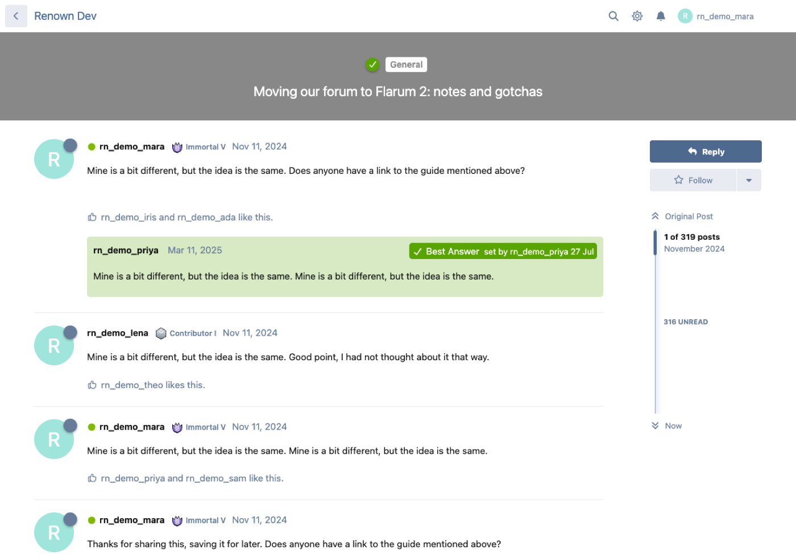
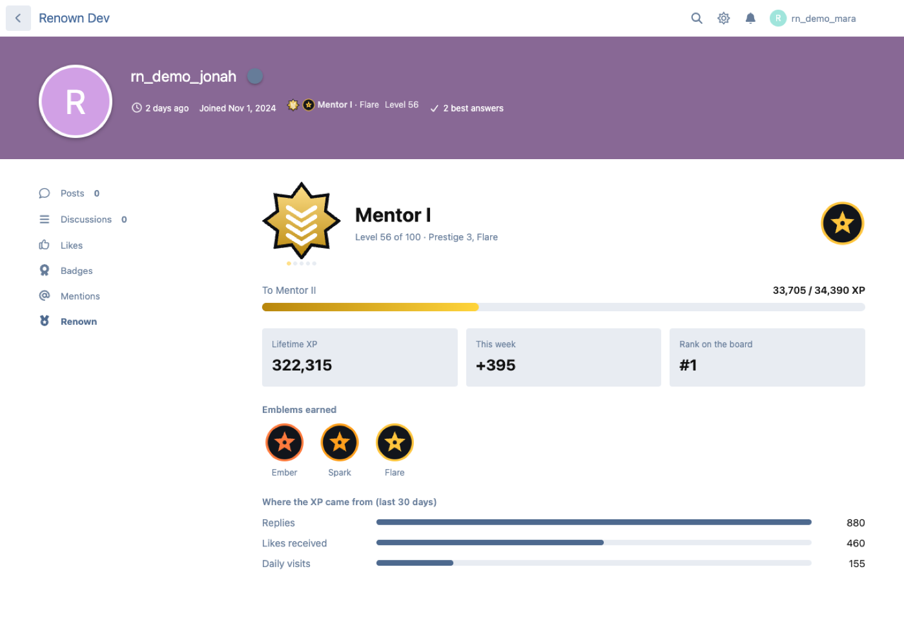
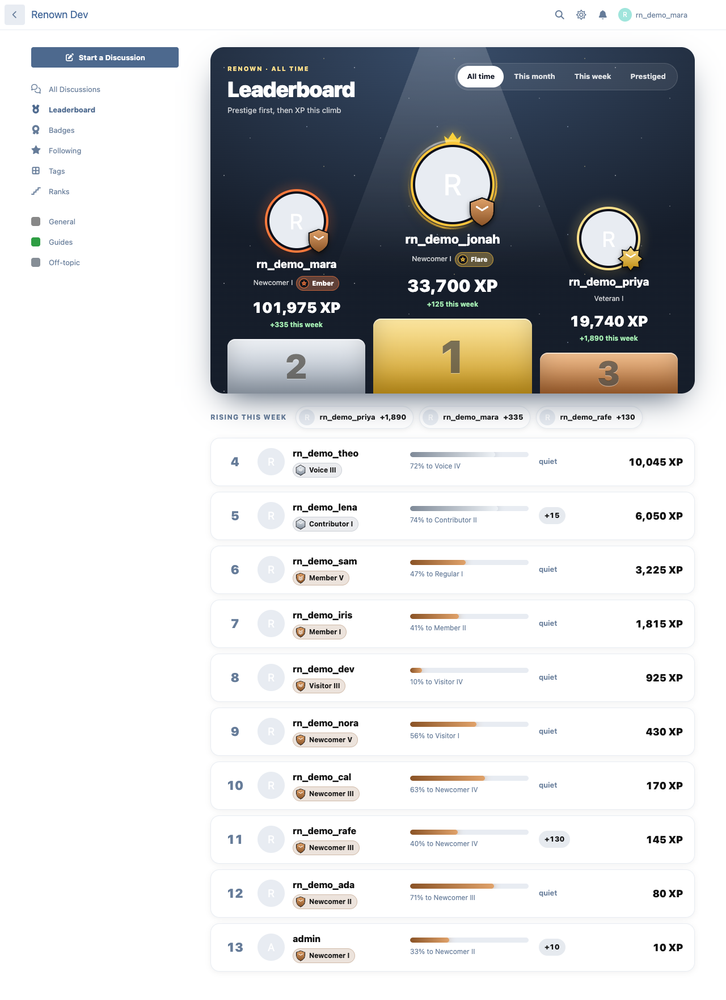
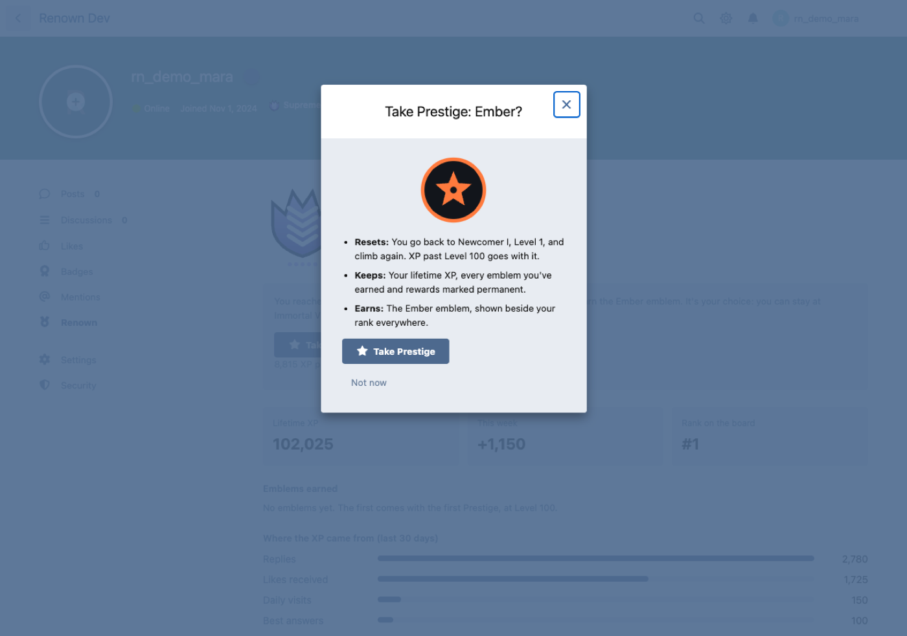

# Renown

XP levels and prestige for Flarum 2. Members earn XP by taking part and climb **100 levels**: 20 ranks of five grades each, from Newcomer I to Immortal V, each with its own insignia. At Level 100 a member may take **Prestige**: start again at Newcomer I and earn a celestial emblem. Twenty tiers, then Eternal.

- Rank and emblem beside every post and on user cards
- "Ranked up" toast, a leaderboard (the top three on a podium; all time, this month, this week and the prestiged; the week's risers; and your own standing pinned at the bottom), and a Renown tab on profiles: progress, lifetime XP, emblems earned, where the XP came from
- XP for replies, new discussions, likes received, best answers (FoF Best Answer or Answers), daily visits, Cadence streak days, Kudos received, Answers upvotes, approved Testimonials (once per subject), finished Corkboard cards and Panels chapters published and read; every value editable
- Anti-farming for new activity: daily cap, like limits, minimum reply length, a cooldown, excluded tags. XP is taken back when a post is hidden or deleted, a like removed or a best answer unmarked
- On install, members get the XP their history earned (no caps for history); nobody is moved into Prestige automatically
- Double XP events, rank name packs (Classic, Military, Fantasy, Sports), your own icons per rank and tier, group rewards per rank and per tier (optionally kept for good)
- FoF Badges metrics (level, prestige tier, lifetime XP), Buzz broadcasts, staff XP adjustments with a reason, GDPR export









## Install

```sh
composer require ernestdefoe/renown
php flarum migrate
php flarum cache:clear
```

Enable Renown in the admin. The history replay runs in the background (the scheduler, the admin page while it's open, or `php flarum renown:rebuild`).

## Update

```sh
composer update ernestdefoe/renown
php flarum migrate
php flarum cache:clear
```

MIT licensed. ☕ [Buy me a coffee](https://buymeacoffee.com/ernestdefoe)
